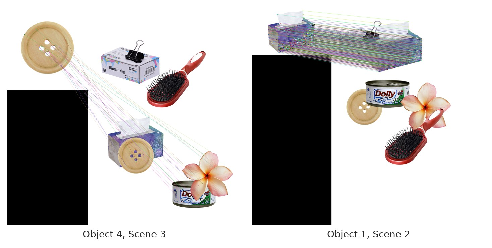

# Object Detection Under Occlusion

Course project for *Digital Image Processing and Analysis* at FER, University of Zagreb (2025).
Group project by Petra Buršić, Dora Folo, Marko Habijanec, Luka Miličević, Matko Pribičević and Hana Šlipogor.

We compared classical feature matching (SIFT, ORB) with deep learning methods (SuperPoint + SuperGlue, SAM + DINOv2) for finding objects in scenes where they are partly hidden. For evaluation, we built a dataset of 6 objects in 20 scenes, with ground-truth masks showing which object each pixel belongs to.

SIFT was far more reliable than ORB, and SuperPoint + SuperGlue coped with occlusion better than both classical methods, though accuracy still dropped as objects became more hidden.

## Contents

- `src/superpoint_superglue_matching.py`: SuperPoint + SuperGlue matching (requires [SuperGluePretrainedNetwork](https://github.com/magicleap/SuperGluePretrainedNetwork) cloned into `src/`)
- `docs/slides.pdf`: project presentation
