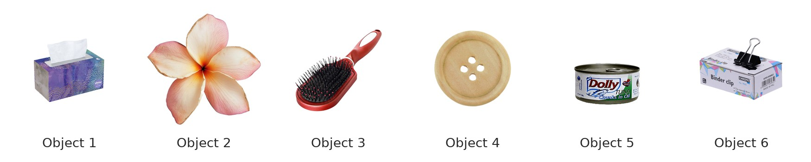
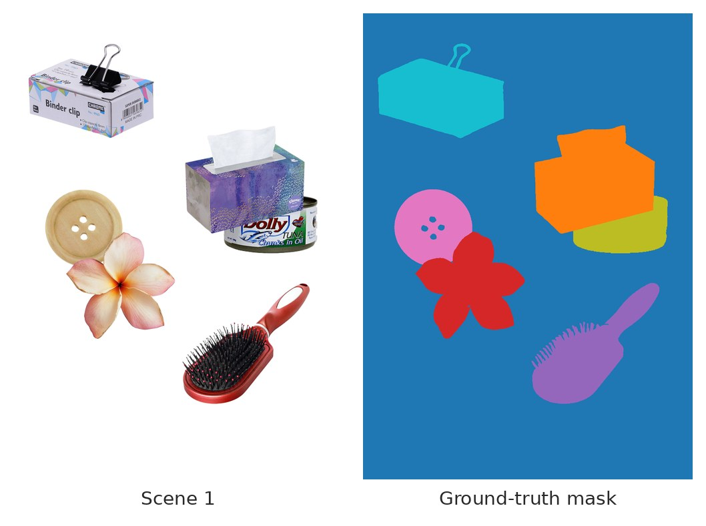
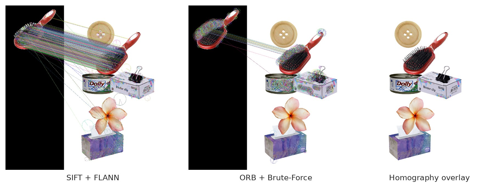
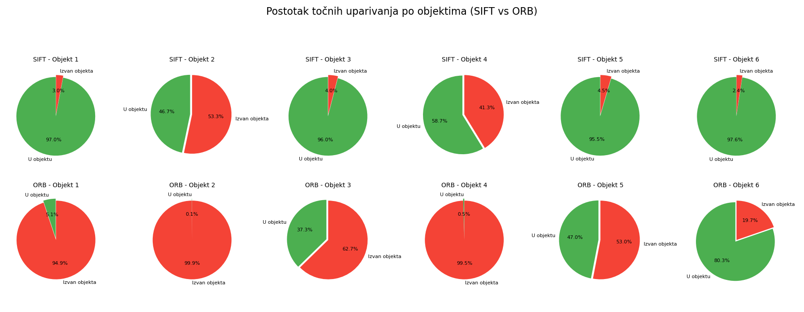
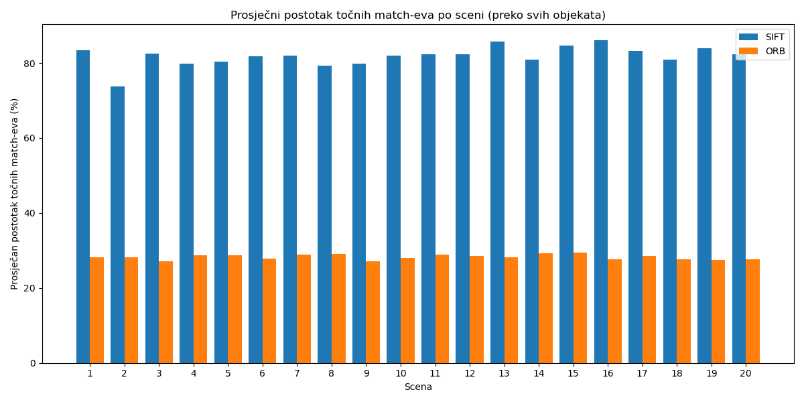
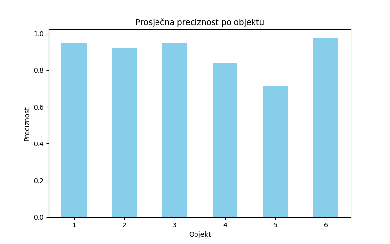
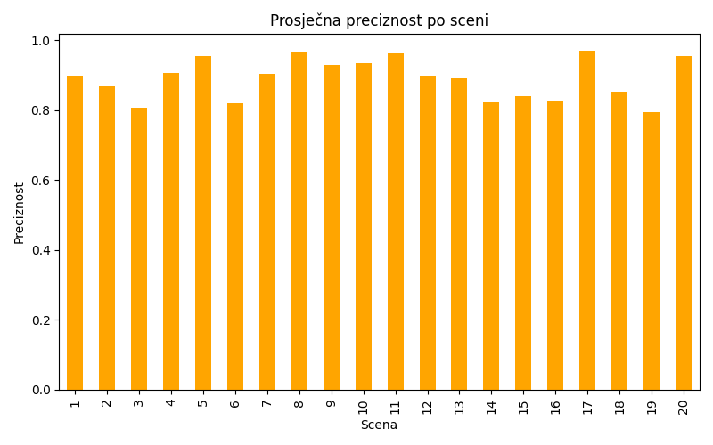
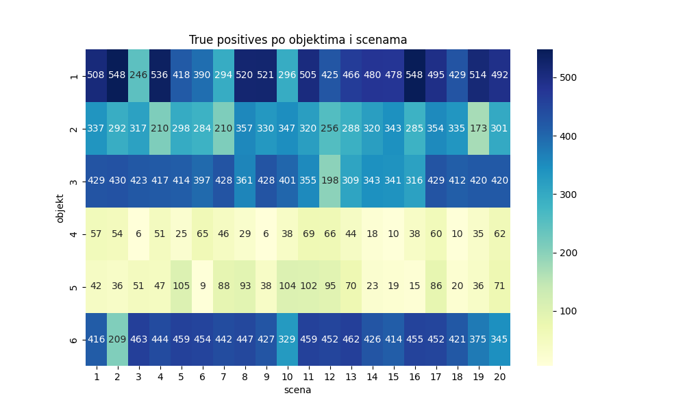
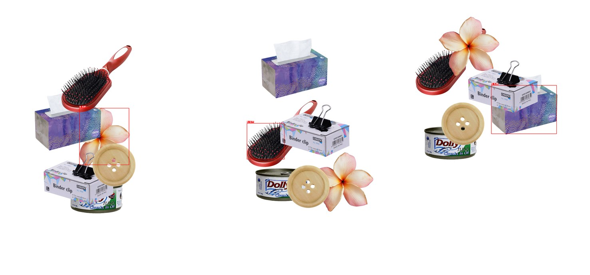

# Object Detection Under Occlusion

**Course project – Digital Image Processing and Analysis, FER, University of Zagreb (June 2025)**

How well can different computer vision methods find a known object in a cluttered scene when it is partly hidden behind other objects? This project compares **classical feature matching (SIFT, ORB)** with **deep learning approaches (SuperPoint + SuperGlue, SAM + DINOv2)** on a custom dataset with pixel-accurate ground-truth masks for quantitative evaluation.



---

## Dataset

Because no models were trained, a small purpose-built dataset was enough:

- **6 objects** with different amounts of texture, each cropped as a transparent `.png`
- **20 scenes** containing the objects in different poses and levels of overlap, composed in Canva
- **Ground-truth masks:** object positions and sizes were exported from Canva to `.csv`, and each object's alpha channel was placed onto a blank 1587×2245 canvas. Each pixel of the resulting `.npy` mask stores the ID of the object it belongs to (0 = background).



The masks make it possible to check automatically whether a matched keypoint actually lies on the queried object, giving true positives, false positives and precision for every object–scene pair.

---

## Methods

| Pipeline | Detection / description | Matching | Localization |
|---|---|---|---|
| **SIFT** | DoG keypoints, 128-D descriptors | FLANN | Homography with RANSAC |
| **ORB** | FAST keypoints, binary rBRIEF descriptors | Brute-Force (Hamming) | Homography with RANSAC |
| **SuperPoint + SuperGlue** | SuperPoint CNN (keypoints + descriptors in one pass) | SuperGlue attention-based matcher, indoor weights | Matched keypoints in scene |
| **SAM + DINOv2** | SAM (`vit_b`) automatic mask generator proposes regions | Cosine similarity of DINOv2 embeddings (query vs. each segment) | Bounding box of best segment above threshold |

For the classical methods, the homography is estimated robustly with RANSAC and the object image is warped onto the scene to visualize its location:



A DINOv2-only variant using overlapping sliding-window patches and Non-Maximum Suppression was also tested. It was slower and gave worse results than SAM + DINOv2.

---

## Results

### SIFT vs. ORB

SIFT outperformed ORB in every scene. Averaged over all objects, around **80–90% of SIFT matches were correct**, compared with **mostly under 40% for ORB**. Both detectors are drawn toward heavily textured objects, so matches for plainer objects tend to land on the wrong object. ORB with brute-force matching suffers from this far more.


*Share of correct (green) and incorrect (red) matches per object, SIFT vs. ORB.*


*Average percentage of correct matches per scene across all objects (blue: SIFT, orange: ORB).*

### SuperPoint + SuperGlue

Matching held up better under occlusion than the classical methods, but accuracy still dropped clearly compared with unoccluded views. Results depended much more on the object than on the scene. **Object 6 reached near-perfect precision** and **Object 5 the lowest**. Objects 4 and 5 produced the fewest correct matches and Object 1 the most.


| Precision per object | Precision per scene |
|---|---|
|  |  |


*Number of true-positive matches for every object (rows) and scene (columns).*

### SAM + DINOv2

In most cases the semantic approach located the queried object correctly. Its main weaknesses:

- **Threshold sensitivity:** a similarity threshold that is too low produces false detections.
- **Overlap:** when objects overlap, SAM can merge them into one region, so the bounding box spills onto a neighboring object.
- **Similar shapes:** DINOv2 matches on what an object *is* rather than its exact texture. That helps when objects belong to different categories but causes confusion between similar shapes.



### Conclusion

Classical features are fast and interpretable but fragile under occlusion and low texture, with SIFT far more reliable than ORB. Learned matching (SuperPoint + SuperGlue) is more robust, and its precision varies mainly with object texture and the amount of occlusion. Semantic matching (SAM + DINOv2) recognizes objects at a higher level but struggles with overlapping or similar-looking objects.

---

## Repository contents

```
├── README.md
├── requirements.txt
├── src/
│   └── superpoint_superglue_matching.py   # SuperPoint + SuperGlue matching for all object–scene pairs
└── docs/
    ├── slides.pdf                          # project presentation
    └── figures/                            # result figures used in this README
```

This repository is an archive of the project. The original dataset and the scripts for the SIFT/ORB, SAM + DINOv2 and evaluation stages were not preserved, so the figures above come from the final presentation.

## Running the SuperPoint + SuperGlue script

```bash
git clone https://github.com/foradolo/object-detection-under-occlusion.git
cd object-detection-under-occlusion
pip install -r requirements.txt

# SuperGlue code and pretrained weights (not included here; see license note below)
git clone https://github.com/magicleap/SuperGluePretrainedNetwork.git src/SuperGluePretrainedNetwork

# Add your own images: object crops in data/objects/, scenes in data/scenes/ (both .png)
python src/superpoint_superglue_matching.py
```

For each object–scene pair, the script writes to `outputs/`:
- `<object>_<scene>.png`: side-by-side visualization of the matches
- `<object>_<scene>.txt`: runtime, keypoint counts and number of matches
- `<object>_<scene>.csv`: coordinates of matched scene keypoints, used for evaluation against the masks

The SuperGlue code and weights are released by Magic Leap under a non-commercial research license, which is why they are cloned separately rather than included here.

---

## Team

Petra Buršić, Dora Folo, Marko Habijanec, Luka Miličević, Matko Pribičević, Hana Šlipogor

**My role:** _TODO: describe your part (e.g. which pipeline you implemented, the evaluation, the dataset/masks)_

## References

- D. G. Lowe, *Distinctive Image Features from Scale-Invariant Keypoints*, IJCV 2004
- E. Rublee et al., *ORB: An Efficient Alternative to SIFT or SURF*, ICCV 2011
- D. DeTone, T. Malisiewicz, A. Rabinovich, *SuperPoint: Self-Supervised Interest Point Detection and Description*, CVPRW 2018, [arXiv:1712.07629](https://arxiv.org/abs/1712.07629)
- P.-E. Sarlin et al., *SuperGlue: Learning Feature Matching with Graph Neural Networks*, CVPR 2020, [arXiv:1911.11763](https://arxiv.org/abs/1911.11763)
- M. Oquab et al., *DINOv2: Learning Robust Visual Features without Supervision*, [arXiv:2304.07193](https://arxiv.org/abs/2304.07193)
- A. Kirillov et al., *Segment Anything*, ICCV 2023, [arXiv:2304.02643](https://arxiv.org/abs/2304.02643)
